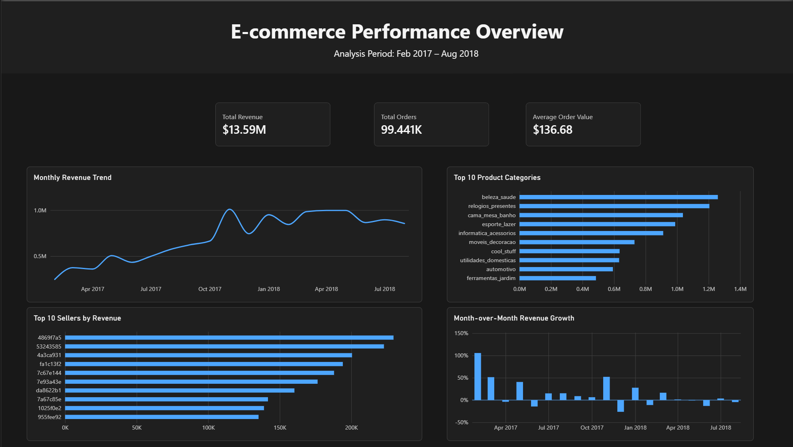

# E-commerce Performance Analysis

End-to-end analysis of a multi-table Brazilian e-commerce dataset using Python, PostgreSQL, SQL, Excel, and Power BI.

## Project Overview

This project analyzes the Olist Brazilian e-commerce dataset using a realistic analytics workflow.

The project focuses on:
- Data validation and preparation with Python and Pandas
- Building tables at different levels of granularity
- Preventing row multiplication during joins
- Loading transformed data into PostgreSQL
- Performing business analysis with SQL
- Exporting selected results to Excel
- Building an interactive Power BI dashboard

## Data Pipeline

Raw CSV Files  
→ Python / Pandas  
→ Data Validation & Pre-Aggregation  
→ PostgreSQL  
→ SQL Analysis  
→ Excel  
→ Power BI

The workflow separates data preparation, SQL analysis, spreadsheet validation, and dashboard reporting into distinct stages.

## Data Model

The project uses two analytical tables with different grains:

### `orders_master`
**Grain:** one row per order.

Contains:
- Order status and timestamps
- Customer information
- Order-level item revenue
- Freight totals
- Payment totals
- Review metrics

### `items_fact`
**Grain:** one row per order item.

Contains:
- Product information
- Product category
- Seller information
- Item price
- Freight value

To avoid row multiplication from one-to-many joins, child tables such as order items, payments, and reviews were pre-aggregated before being merged into the order-level table.

## Data Validation

Several validation checks were performed throughout the project to ensure consistency between table grains and prevent inflated metrics.

Key checks included:
- Verifying row counts and unique order IDs
- Checking missing relationships between orders, items, payments, and reviews
- Measuring one-to-many relationships before joining tables
- Confirming that order-level revenue matched item-level revenue

Final revenue validation:

`SUM(orders_master.total_item_value)` ≈ `SUM(items_fact.price)` ≈ **R$13.59M**

## SQL Analysis

The SQL analysis focuses on business performance, customer behavior, delivery performance, and seller performance.

Examples include:
- Revenue and order volume by customer state
- Top product categories by revenue
- Average order value by state
- Top sellers by revenue
- Repeat customer analysis
- Month-over-month revenue growth using `LAG()`
- Top 3 product categories within each state using `DENSE_RANK()`
- Late delivery rate and average delay by state

Advanced SQL techniques used in the project include CTEs, window functions, ranking, conditional aggregation, date aggregation, and validation queries across different table grains.

## Power BI Dashboard

The final dashboard provides a high-level view of e-commerce performance.

Key visuals include:
- Total Revenue
- Total Orders
- Average Order Value
- Monthly Revenue Trend
- Month-over-Month Revenue Growth
- Top 10 Product Categories by Revenue
- Top 10 Sellers by Revenue

A dedicated Date Table was used for time intelligence, including previous-month revenue and month-over-month growth calculations.

### Dashboard Preview

## Key Findings

- Total analyzed revenue was approximately **R$13.59M**.
- Revenue increased significantly throughout 2017 and remained relatively high during 2018.
- A small group of product categories generated a large share of total item revenue.
- Seller performance was highly concentrated, with the top sellers generating substantially more revenue than the majority of sellers.
- Month-over-month growth showed strong fluctuations, especially during earlier periods with lower revenue volume.
- Delivery performance varied by customer state, with some states showing noticeably higher late-delivery rates.

## Tools & Technologies

- Python
- Pandas
- PostgreSQL
- SQL
- SQLAlchemy
- Excel
- Power BI
- DAX